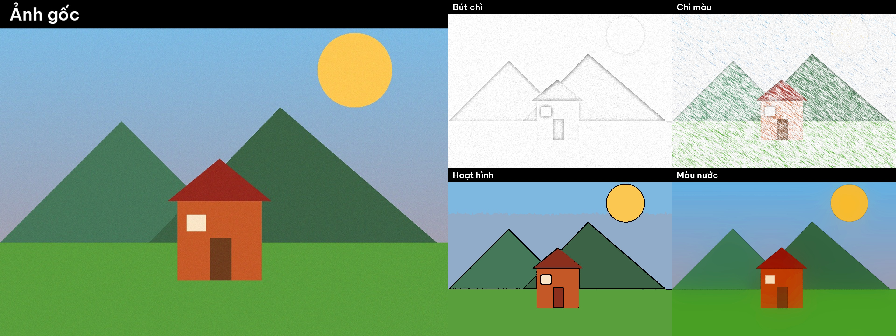

# butchi ✏️

**Biến một tấm ảnh thường thành tranh bút chì, chì màu, hoạt hình và màu nước trong chưa tới 1 giây.** Chạy hoàn toàn offline trên máy anh, miễn phí, không cần tài khoản, không cần GPU, không gửi ảnh lên mạng như các app chỉnh ảnh trả phí.



## Có gì

| Kiểu | Lệnh | Cách làm |
|---|---|---|
| Bút chì | `but-chi` | Ảnh xám chia cho bản mờ của ảnh âm bản, thêm vân giấy |
| Chì màu | `chi-mau` | Màu phẳng tô bằng nét gạch chéo trên nền giấy trắng, viền chì |
| Hoạt hình | `hoat-hinh` | Gom màu bằng k-means và viền đen |
| Màu nước | `mau-nuoc` | Làm phẳng màu, loang mép, tăng độ tươi |

Mỗi lần chạy, tool lưu từng kiểu ra file riêng và ghép thêm một **ảnh so sánh** (ảnh gốc cạnh các bản tranh) để đăng mạng xã hội luôn.

## Cài đặt

Cần Python 3.9 trở lên.

```bash
git clone https://github.com/vietphan98/butchi.git
cd butchi
python3 -m venv .venv
source .venv/bin/activate      # Windows: .venv\Scripts\activate
pip install -r requirements.txt
```

## Cách dùng

```bash
# Tất cả các kiểu
python -m butchi anh_cua_toi.jpg

# Chỉ bút chì và hoạt hình, lưu vào thư mục khác
python -m butchi anh_cua_toi.jpg -k but-chi hoat-hinh -o tranh

# Ảnh to hơn (mặc định cạnh dài 1080px)
python -m butchi anh_cua_toi.jpg --kich-thuoc 1600
```

Kết quả nằm trong thư mục `ket_qua/`: `<ten>_but-chi.png`, `<ten>_chi-mau.png`, `<ten>_hoat-hinh.png`, `<ten>_mau-nuoc.png` và `<ten>_so_sanh.jpg`.

Chưa có ảnh để thử thì tạo ảnh mẫu:

```bash
python examples/tao_anh_mau.py
python -m butchi examples/anh_mau.jpg
```

## Demo quay Reel (20-30 giây)

1. Mở terminal cạnh một tấm ảnh chân dung hoặc phong cảnh thật (ảnh selfie, ảnh thú cưng, ảnh phố đều đẹp).
2. Gõ `python -m butchi selfie.jpg`; màn hình in ra từng kiểu "xong sau 0.1s".
3. Mở `ket_qua/selfie_so_sanh.jpg`: ảnh gốc và 4 bản tranh hiện cạnh nhau.
4. Zoom vào bản bút chì và hoạt hình để thấy nét vẽ.

**Câu hook gợi ý:** "Có thằng họa sĩ vẽ em mất 3 ngày, cái tool miễn phí này vẽ lại trong 1 giây."

## Chạy test

```bash
pip install pytest
python -m pytest -q
```

## Giấy phép

MIT, tác giả Viet Phan. Xem file [LICENSE](LICENSE).
